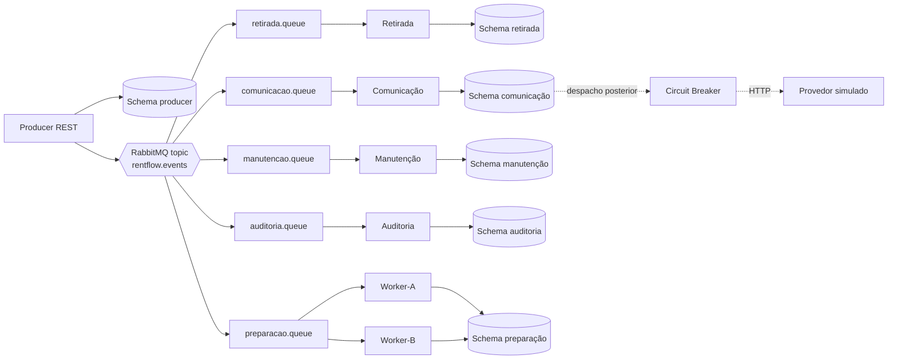
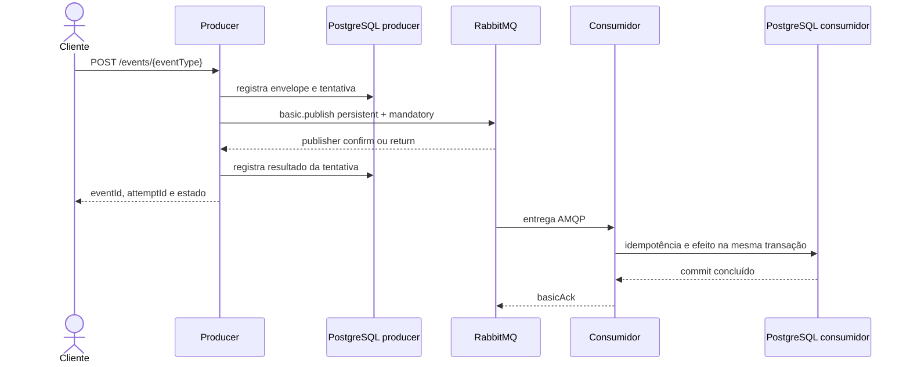

# Arquitetura do RENTFLOW

## Visão geral



O producer recebe comandos HTTP síncronos, registra o envelope e publica o fato por AMQP. RabbitMQ cria uma cópia por fila compatível com a routing key. Cada consumidor persiste somente em seu schema. As duas instâncias de preparação competem pelas entregas da mesma fila.

## Sequência de publicação e consumo



Publisher confirm é a resposta do broker ao produtor. Consumer ACK é a confirmação do consumidor sobre uma entrega. O listener envia `basicAck` somente depois que o serviço transacional retorna com o commit concluído.

## Roteamento

Exchange principal: `rentflow.events`, tipo `topic`, durável e não auto-delete.

| Fila | Binding |
|---|---|
| retirada.queue | `reserva.confirmada` |
| comunicacao.queue | `reserva.confirmada` |
| comunicacao.queue | `reserva.cancelada` |
| comunicacao.queue | `inspecao.reprovada` |
| manutencao.queue | `inspecao.#` |
| auditoria.queue | `#` |
| preparacao.queue | `reserva.confirmada` |

### Matriz evento × consumidor

| Evento | Retirada | Comunicação | Manutenção | Auditoria | Preparação |
|---|---:|---:|---:|---:|---:|
| `reserva.confirmada` | sim | sim | não | sim | sim |
| `reserva.cancelada` | não | sim | não | sim | não |
| `inspecao.aprovada` | não | não | sim | sim | não |
| `inspecao.reprovada` | não | sim | sim | sim | não |

`inspecao.#` aceita qualquer evento da família de inspeção. `#` faz a auditoria receber todos os eventos encaminhados pela exchange. Assim, `inspecao.agendada` chega à manutenção e auditoria, enquanto um tipo como `equipamento.cadastrado` chega somente à auditoria.

### Direct, fanout e topic

| Tipo | Regra | Consequência no RENTFLOW |
|---|---|---|
| Direct | igualdade exata da routing key | exigiria novos bindings para cada tipo de inspeção |
| Fanout | envia a todas as filas ligadas | não separaria responsabilidades |
| Topic | compara segmentos e aceita `*` e `#` | combina rotas exatas, famílias e auditoria abrangente |

Topic foi escolhido porque atende, na mesma exchange, eventos específicos, famílias extensíveis e captura abrangente.

## Confiabilidade

- Exchange e filas são duráveis; mensagens são publicadas com `delivery_mode=2`.
- O producer usa publicação `mandatory`, publisher confirms correlacionados, returns e timeout limitado.
- O consumo usa ACK manual, prefetch baixo e retries finitos. Mensagens permanentemente inválidas ou com tentativas esgotadas seguem para `rentflow.estacionamento`.
- Cada responsabilidade possui `processed_events` com unicidade de `event_id`. O `INSERT ... ON CONFLICT DO NOTHING` e o efeito ocorrem na mesma transação.
- Retirada também possui unicidade de `reserva_id`; preparação compartilha a constraint entre Worker-A e Worker-B.
- Uma duplicata com envelope idêntico recebe ACK sem repetir efeito. Mesmo `eventId` com conteúdo diferente é tratado como colisão.

O sistema oferece processamento *at-least-once* com efeitos idempotentes. Uma queda após commit e antes do ACK pode provocar reentrega; a constraint impede novo efeito.

## Circuit Breaker

Comunicação primeiro persiste o aviso `PENDING`, conclui o commit e envia o ACK RabbitMQ. O despacho HTTP é uma operação separada:

```text
aviso PENDING → Circuit Breaker → provedor HTTP simulado
```

O circuito `notificationProvider` usa janela baseada em contagem de 4 chamadas, mínimo 4, limiar de falha de 50%, espera de 10 segundos e 2 permissões em `HALF_OPEN`. Uma chamada bloqueada não chega ao provedor nem incrementa o contador HTTP. O Circuit Breaker não protege RabbitMQ e não condiciona o ACK do listener.

## Persistência e limites

Uma instância PostgreSQL contém schemas isolados por responsabilidade e logins com acesso restrito. Isso organiza propriedade dos dados, mas não isola falhas da instância. RabbitMQ e PostgreSQL executam em nó único. Também existe uma janela entre persistir o fato e publicar no broker; replay manual é a recuperação implementada e Transactional Outbox seria uma evolução.
