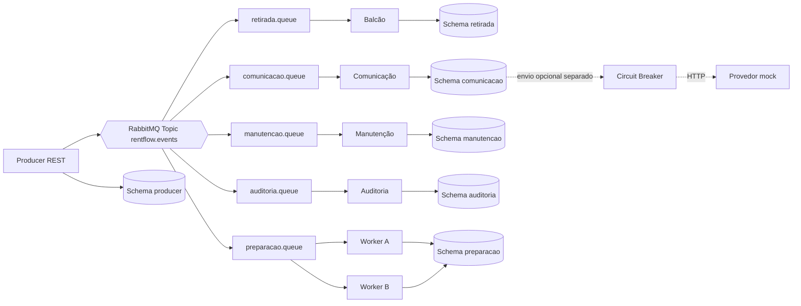

# Arquitetura e decisões propostas

## D01 — Topologia

Uma instância PostgreSQL, schemas isolados por responsabilidade; nenhum consumidor consulta tabelas de outro. Isso simplifica o laboratório, mas é infraestrutura compartilhada e não demonstra isolamento de falhas do banco. Um broker em nó único não representa alta disponibilidade.

| Fila | Bindings |
|---|---|
| retirada.queue | reserva.confirmada |
| comunicacao.queue | reserva.confirmada; reserva.cancelada; inspecao.reprovada |
| manutencao.queue | inspecao.# |
| auditoria.queue | # |
| preparacao.queue | reserva.confirmada |

| Evento | Retirada | Comunicação | Manutenção | Auditoria | Preparação |
|---|---|---|---|---|---|
| reserva.confirmada | sim | sim | não | sim | sim |
| reserva.cancelada | não | sim | não | sim | não |
| inspecao.aprovada | não | não | sim | sim | não |
| inspecao.reprovada | não | sim | sim | sim | não |
| inspecao.agendada (extra) | não | não | sim | sim | não |
| equipamento.cadastrado (extra) | não | não | não | sim | não |

Topic aceita correspondência exata e padrões por segmentos (`*`: um segmento; `#`: zero ou mais). Direct exige correspondência exata e novos bindings para novos tipos; Fanout distribui a todas as filas ligadas sem seleção. Auditoria com `#` recebe qualquer chave publicada nesta exchange: logo um evento novo sem regra específica ainda chega à auditoria. Não é um caso de mensagem sem rota. Preparação tem uma fila, não duas; cada entrega normal é atribuída a um worker; redelivery é possível e divisão igual não é garantida.

## D02 — Persistência e ACK
- Exchange e filas duráveis, não exclusivas e sem auto-delete, declaradas antes de aceitar publicação (infra bootstrap); mensagem persistente; volume local. Escolher e documentar o tipo de fila (classic durável é suficiente no nó único).
- Configurar ACK manual e prefetch 1 para facilitar visualização de concorrência. Cada listener valida, chama serviço transacional separado, espera seu retorno após commit, então ACK. Não executar ACK dentro de método cujo commit ainda não ocorreu.
- Dedupe transacional com INSERT ... ON CONFLICT DO NOTHING para chave event_id por consumidor e efeito na mesma transação. Retirada também UNIQUE(reserva_id). Preparação compartilha unicidade entre workers. Duplicata reconhecida: ACK sem novo efeito. Registrar tentativa duplicada em log, não duplicar efeito. Conflitos de negócio com novo eventId: registrar e explicar política; não sobrescrever silenciosamente.
- Em falha não confirmar sucesso. Definir tratamento finito: erros inválidos/permanentes rejeitados e encaminhados para DLQ se configurada; transitórios com retry limitado e destino de falha verificável. Evitar requeue infinito. Para o teste de falha entre commit e ACK, usar gancho de teste local, nunca depender de timing aleatório.
- Producer registra fato e payload original com estado PENDING; publica com confirm e mandatory/returns, marca PUBLISHED após confirmação positiva e ausência de return. Falha ou timeout deixa estado não confirmado; replay republica o JSON original com mesmo eventId e occurredAt. Não alegar atomicidade DB/broker: janela entre publicação e atualização é limitação; replay idempotente é estratégia mínima, outbox automático é extensão não obrigatória. HTTP não espera processamento de consumidores. Status de publicação não é status de consumo.

## D03 — Circuit Breaker HTTP isolado
Comunicação registra o aviso `PENDING` e envia ACK depois do commit, sem chamar HTTP no listener. O endpoint manual de despacho reivindica o aviso com token e prazo, incrementa a tentativa somente depois de obter permissão do circuito e então chama o provedor real por HTTP. Falha externa devolve o aviso a `PENDING`; bloqueio registra `bloqueios_circuito` sem incrementar chamada HTTP; somente HTTP 200 permite `SENT`.

O Resilience4j 2.4.0 protege exclusivamente `ProvedorNotificacaoClient.enviar`. A instância programática `notificationProvider` usa `COUNT_BASED`, janela 4, mínimo 4, limiar 50%, espera 10 s e duas chamadas em `HALF_OPEN`. A transição automática está explicitamente desativada; depois da espera, a próxima aquisição de permissão faz a transição preguiçosa para `HALF_OPEN`. O cliente limita conexão a 1 s e leitura a 2 s. Não há retry nem agendador automático.

O provedor local usa `jdk.httpserver`, vincula-se a `127.0.0.1:8090`, alterna HTTP 200/503 e deduplica em memória pelo `eventId` recebido em `Idempotency-Key`. A reivindicação no PostgreSQL impede tentativas locais simultâneas. Ainda existe uma janela entre sucesso externo e atualização local; a chave idempotente reduz a duplicação somente quando o provedor a respeita. Isso não constitui entrega exactly-once.

## D04 — Estrutura proposta
Maven multi-module: shared/event-contracts, producer, consumers/{retirada,comunicacao,manutencao,auditoria,preparacao}. Cada app Spring Boot tem main, configurações e Dockerfile/build reproduzível. Duas réplicas do mesmo artefato preparação com WORKER_ID distintos; sem portas fixas conflitantes. Infra RabbitMQ definitions ou bootstrap único reproduzível; PostgreSQL migrations versionadas; scripts PowerShell. Logs estruturados com eventId, eventType, consumer, workerId, outcome, timestamp. Endpoints GET de consulta somente locais; sem leitura de dados de outros schemas. Fixar versões após resolver dependências. Não introduzir Lombok/JPA por padrão.

## D05 — Infraestrutura executada na Etapa 01

O `compose.yaml` define um **message broker**, o RabbitMQ, que recebe publicações e guarda nas filas as cópias encaminhadas. O **virtual host** rentflow organiza nomes e permissões dentro do broker. O nome rentflow_default identifica a rede Docker entre os contêineres. O PostgreSQL usa um volume próprio e ainda não tem tabelas de negócio. Os schemas por responsabilidade continuam previstos em D01.

No futuro produtor, **AMQP 0-9-1** será o protocolo de publicação. O cliente abrirá uma **conexão TCP** na porta 5672 e poderá multiplexar vários **channels**, sessões lógicas que compartilham essa conexão. No experimento, `scripts/roteamento.ps1` usou HTTP na porta 15672 para publicar pela **Management API** e consultar métricas. A aplicação Java ainda não participa desse caminho.

A **exchange** rentflow.events recebe a mensagem junto com sua **routing key**, como inspecao.aprovada. Cada **binding** associa uma fila à exchange e define um padrão. A **queue** guarda a cópia enquanto aguarda entrega. Veja `infra/rabbitmq/definitions.json`: inspecao.# alcança a manutenção, e # alcança a auditoria. **Topic** compara segmentos, **direct** compara chaves exatas e **fanout** envia uma cópia a cada fila vinculada. Por isso um único padrão de manutenção já cobre inspecao.agendada.

Quatro filas receberam reserva.confirmada. Em cada fila a cópia pode aguardar independentemente. Quando houver dois **competing consumers** em preparacao.queue, os dois disputarão as entregas da mesma fila. A topologia contém uma única fila de preparação.

As filas **duráveis** mantêm suas definições ao reiniciar o broker. As mensagens publicadas com **delivery_mode=2** solicitam persistência. O volume rabbit-data guarda os arquivos do nó, cujo hostname permanece fixo. No laboratório, as 14 cópias continuavam prontas após stop/start. O TTL de uma hora limita apenas as mensagens do teste. A infraestrutura tem um único nó.

Um **publisher confirm** é uma resposta do broker ao publicador AMQP. O **consumer ACK** parte de quem recebeu uma entrega e permite que o broker a considere confirmada. No desenho futuro, o ACK sucede o commit do efeito local. Aqui, routed=true informa que a publicação HTTP encontrou destino. A medição de Ready por fila identifica os destinos observados.

**Inicialização em volumes existentes.** O ponto de entrada operacional é iniciar.ps1. O Compose cria usuários e banco padrão na inicialização dos volumes vazios; preserve o .env para reutilizá-los. Alterar a senha no arquivo não atualiza usuários já persistidos. O script importa novamente as definições via rabbitmqctl e espera a verificação da Management API antes de liberar o laboratório. A importação conserva mensagens e não remove automaticamente definições antigas; alterações incompatíveis podem falhar. Investigue divergências com topologia.ps1 antes de publicar. Um simples docker compose up em volumes novos só inicia os serviços. [Definições do RabbitMQ](https://www.rabbitmq.com/docs/definitions)

## D06 — Núcleo em execução no Windows

RabbitMQ e PostgreSQL permanecem no Compose. As cinco responsabilidades e o produtor são aplicações Spring Boot locais; scripts/apps.ps1 inicia sete processos com identificadores distintos, seis JARs, HTTP em loopback e prefetch 1. A preparação compartilha a fila e o schema. O caminho produtor → exchange → filas → efeitos corresponde a D01. Cada aplicação usa um login JDBC próprio; a migração em infra/sql e as concessões de scripts/acessos-db.ps1 tornam o isolamento verificável no catálogo PostgreSQL.

O histórico de tentativas em producer.tentativas distingue o UUID de confirmação do UUID de domínio. Os consumidores gravam processed_events e efeitos na mesma transação PostgreSQL. O ACK ocorre no listener após o retorno do proxy transacional. Para falhas, a política declarada em infra/rabbitmq/estacionamento.json acrescenta a exchange fanout rentflow.falhas e uma única fila auxiliar. As filas principais mantêm seus argumentos originais. O preparador só instala uma política nova após verificar que as filas estão vazias para preservar o comportamento de TTL dos testes anteriores.

O [guia de leitura](GUIA-DO-CODIGO.md) explica o protocolo de entrega, a comparação de envelopes em jsonb, a janela entre banco e broker, os limites do estacionamento em filas classic e o gancho local de falha após commit. A decisão D03 foi implementada como uma integração opcional e explicitamente separada do ACK RabbitMQ.
